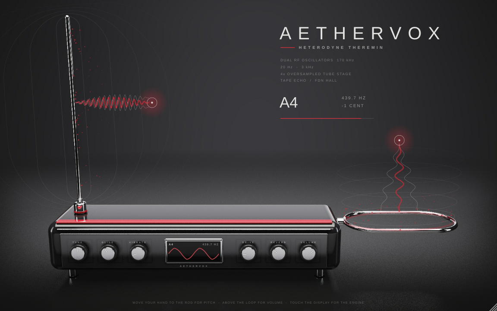
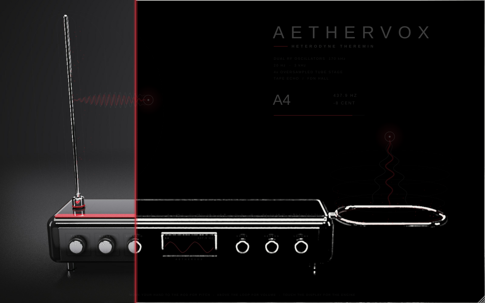
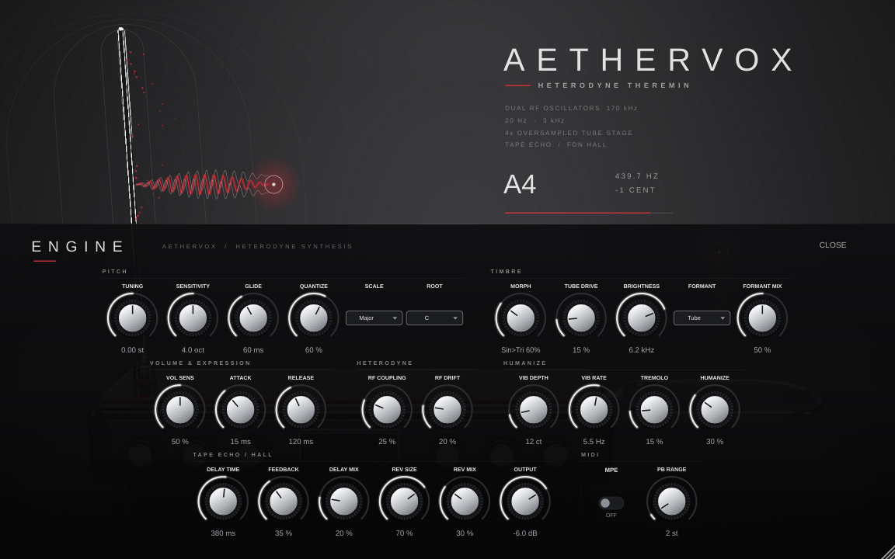

# AetherVox – Heterodyne Theremin (VST3 / AU / Standalone)

Luxusní monofonní theremin v JUCE 8, C++17. Rozhraní tvoří fyzikálně renderovaná produktová fotografie nástroje: piano černý lak, oxblood červená laková linka, leštěný chrom a kartáčovaný hliník. Prezentace je ve stylu prémiové produktové stránky.



| Intro „skica → render“ | Engine |
|---|---|
|  |  |

## Build

Potřebuješ CMake ≥ 3.22 a překladač s C++17. JUCE se stáhne automaticky (8.0.4), nebo použij `-DJUCE_DIR=/cesta/k/JUCE`.

```bash
cmake -B build -DCMAKE_BUILD_TYPE=Release
cmake --build build --config Release
```

Výstupy najdeš v `build/AetherVox_artefacts/Release/` (VST3, AU na macOS, Standalone). Test DSP spustíš přes `ctest --test-dir build`.

## Jak se na něj hraje

- **Pitch:** přibližuješ ruku (myš) k svislé chromové tyči. Čím blíž, tím vyšší tón; ruka se může pohybovat i nahoru a dolů podél tyče.
- **Volume:** zvedáš ruku nad vodorovnou smyčkou. Čím výš, tím hlasitěji; u smyčky je ticho. Dvojklik nad smyčkou nástroj ztlumí.
- Ruce zůstávají tam, kam je pustíš, takže nástroj zní dál jako skutečný theremin.
- **Šest knobů na přístroji:** Tune, Glide, Vibrato, Drive, Reverb, Volume. Ovládají se tažením nahoru a dolů, dvojklik je vrátí na výchozí hodnotu a při tažení ukazují bublinu s hodnotou.
- **Klik na displej** vysune panel **ENGINE** se všemi 28 parametry.
- **MIDI z DAW:** noty, pitch bend, CC1/74 (pitch), CC7/11 (volume) a MPE (per-note bend, pressure, slide).

**Při hraní** se pole kolem antén rozvlní: kruhy, vlny mezi rukou a anténou (hustota = výška tónu, výška vln = hlasitost) a jiskry. Na displeji přístroje běží živý průběh vlny a vpravo nahoře je údaj o tónu jako na přístrojové desce.

**Intro** používá techniku z videa: z jednoho renderu se vytáhnou hrany (šedotón → hranové jádro 3×3 `-1 … 8 … -1` → zesílení čar), takže nástroj se nejdřív objeví jako křídová kresba. Pak ho 2px červená linka „dokreslí“ do plného renderu.

## Artwork

Grafiku vytváří `Tools/render/ThereminRender.cpp`, vlastní SDF ray-marcher, který žádné externí 3D nástroje nepotřebuje. Obsahuje:

- materiály: piano lak s clearcoatem, chrom, kartáčovaný hliník, vroubkované knoby, černé sklo
- světlo: plošné softboxy a neviditelnou odrazovou plochu
- prostředí: seamless studio s lesklou podlahou a ACES tónovým mapováním

Hlavy knobů se renderují bez ryski. Ryski kreslí plugin, aby se knoby mohly otáčet. Renderer vypisuje i promítnuté souřadnice antén, knobů a displeje, které používá `Source/GUI/InstrumentView.h` (`namespace Art`).

```bash
g++ -O3 -march=native -std=c++17 -pthread Tools/render/ThereminRender.cpp -o render
./render render.ppm coords.txt 1600 1000 36
```

## DSP (`Source/DSP`, čisté C++)

- dva virtuální RF oscilátory (170 kHz) se směšovačem a vazbou podle Adlerovy rovnice
- morph sine → triangle → saw (BLEP/BLAMP)
- humanize, kvantizér na stupnici, glide
- lampová saturace s 4× oversamplingem
- formanty (Ethereal, Soprano, Tube) a tónová clona
- tape delay, FDN reverb

Testy ověřují ladění (±0,00 ct) a A4 = 440,000 Hz.
